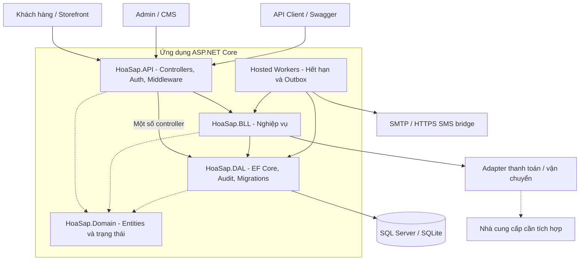

<div align="center">

# Tiệm Hoa Có Gu

**Nền tảng thương mại điện tử hoa sáp & trải nghiệm workshop**

ASP.NET Core 8 · C# · Entity Framework Core 8 · SQL Server / SQLite

[Công nghệ](#công-nghệ-sử-dụng) · [Kiến trúc](#kiến-trúc-hệ-thống) · [Chạy nhanh](#chạy-nhanh) · [API](#tổng-quan-api) · [Tài liệu](#tài-liệu-chuyên-sâu)

</div>

---

## Giới thiệu

**Tiệm Hoa Có Gu** kết hợp bán hoa sáp, đặt hoa theo yêu cầu và đăng ký workshop trong cùng một hệ thống. Repository bao gồm REST API, cửa hàng dành cho khách hàng, CMS quản trị, bộ kiểm thử tự động và công cụ hỗ trợ triển khai, nâng cấp dữ liệu, sao lưu và phục hồi.

Dự án không chỉ dừng ở CRUD: các luồng nghiệp vụ xử lý giữ tồn kho, giữ chỗ có thời hạn, báo giá có phiên bản, thanh toán cọc, giao hàng, hoàn tiền và truy vết thay đổi. Backend được tổ chức theo kiến trúc **N-Layer**, triển khai cùng storefront và Admin CMS mà không cần máy chủ frontend riêng.

> **Trạng thái sandbox:** MoMo payment/refund adapter khóa endpoint ở sandbox; Mailtrap Email Sandbox và Twilio Test Credentials chỉ dùng test mode. GHN staging v3 chỉ đọc danh mục tỉnh/phường; carrier báo phí vẫn `Disabled` do tài liệu phí chưa có mapping được GHN xác nhận từ mô hình địa chỉ mới. Checkout bắt buộc báo giá, không có phí giả. Không dùng live credentials, giao dịch thật, tin nhắn thật hoặc production deployment. Xem [runbook vận hành](docs/operations.md).

## Điểm nổi bật

| Phân hệ | Khả năng chính |
| --- | --- |
| **Cửa hàng** | Danh mục, tìm kiếm và phân trang sản phẩm; giỏ hàng, sổ địa chỉ, voucher, checkout và theo dõi đơn của chính khách hàng. |
| **Đơn hàng & tồn kho** | Giữ kho trong transaction, chống tạo trùng bằng idempotency key, tự hết hạn đơn chưa thanh toán, quản lý phiếu giao và hoàn tiền. |
| **Hoa đặt riêng / preorder** | Yêu cầu → báo giá có revision → khách duyệt → checkout → đặt cọc → sản xuất → sẵn sàng giao → hoàn tất. |
| **Workshop** | Quản lý ca học, giữ chỗ, tiền cọc, roster, check-in, no-show và yêu cầu hoàn tiền. |
| **Admin CMS** | Sản phẩm, danh mục, thư viện ảnh, tài khoản, voucher, tồn kho, đơn hàng, workshop, báo giá custom, dashboard và xuất CSV. |
| **Tài khoản & bảo mật** | JWT, phân quyền Admin/Staff/Customer, đổi và khôi phục mật khẩu, xoay refresh token, thu hồi phiên và kiểm tra quyền sở hữu dữ liệu. |
| **Vận hành** | Audit log, request/trace ID, health checks, limiter dùng chung database, outbox thông báo, migration và công cụ backup/restore. |

## Công nghệ sử dụng

### Nền tảng ứng dụng

| Thành phần | Công nghệ / phiên bản trong repo | Vai trò |
| --- | --- | --- |
| Ngôn ngữ & runtime | **C# · .NET 8** (`net8.0`) | Nền tảng chung cho API, thư viện nghiệp vụ, maintenance CLI và kiểm thử. |
| Web API | **ASP.NET Core 8**, Controllers, Dependency Injection | Cung cấp REST API; middleware xử lý lỗi, bảo mật và chẩn đoán request. |
| Truy cập dữ liệu | **Entity Framework Core 8.0.22** | Ánh xạ entity, truy vấn LINQ, transaction, ràng buộc dữ liệu và migrations SQL Server. |
| Cơ sở dữ liệu | **SQL Server 2022** / **SQLite** | SQL Server có cấu hình Docker và bài kiểm thử riêng; SQLite giúp chạy local mà không cần dựng SQL Server. |
| Xác thực | **JWT Bearer 8.0.22**, PBKDF2-SHA256, ASP.NET Core Data Protection | Access token, băm mật khẩu có salt, bảo vệ link khôi phục và quản lý hiệu lực phiên. |
| Tài liệu API | **OpenAPI / Swagger**, Swashbuckle **6.6.2** | Khám phá schema, request/response và thử API trong Development. |
| Giao diện | **HTML5 · CSS3 · JavaScript thuần** | Storefront và Admin CMS được phục vụ từ `wwwroot`; không có bước build frontend bằng Node. |

### Độ tin cậy, tích hợp & công cụ phát triển

| Thành phần | Công nghệ / cách triển khai | Vai trò |
| --- | --- | --- |
| Tác vụ nền | ASP.NET Core hosted services | Hết hạn đơn, hết hạn giữ chỗ và xử lý outbox trong tiến trình API. |
| Thông báo | Transactional outbox, Mailtrap Email Sandbox, Twilio Test Credentials | Lưu cùng giao dịch; Mailtrap inbox và Twilio API-acceptance giả lập; không gửi email/SMS thật, kết quả mơ hồ bị cách ly. |
| Thanh toán & vận chuyển | MoMo sandbox adapter; GHN v3 address catalog read-only; carrier `Disabled` | MoMo khóa cứng test endpoint, HMAC/IPN và query đối soát; GHN fee mapping chưa được xác minh, không bật endpoint generic/live. |
| Giới hạn lưu lượng | ASP.NET Core Rate Limiting + counter trong database | Luôn có lớp bảo vệ từng process; quota database bật qua `RateLimiting__Distributed=true`, mặc định bật ngoài Development. |
| Kiểm thử .NET | **xUnit 2.9.2**, ASP.NET Core MVC Testing **8.0.22**, Test SDK **17.11.1** | Kiểm thử nghiệp vụ, HTTP API, phân quyền, migration và tích hợp database. |
| Kiểm thử bổ trợ | Node.js test runner, Python 3, k6 | Kiểm tra an toàn storefront, xác minh TRX, smoke-load và kịch bản cạnh tranh nhiều process. |
| Đóng gói | **Docker multi-stage**, runtime ASP.NET 8, user không phải root | Đóng gói API, storefront và CMS trong cùng image. |
| CI | **GitHub Actions**, .NET 8, Node.js 22, SQL Server 2022 service | Restore → build Release → test → kiểm tra kết quả TRX → lưu artifact. |
| Nâng cấp & phục hồi | `dotnet-ef` **8.0.22**, maintenance CLI, Bash/Python, `sqlcmd` | Migration SQL Server, nâng cấp SQLite có dữ liệu và backup/restore thủ công. |

Các phiên bản được khai báo tại các tệp `.csproj`, [tool manifest](.config/dotnet-tools.json) và [workflow CI](.github/workflows/dotnet.yml). Node.js/Python/k6 là công cụ kiểm thử hoặc vận hành, **không phải dependency để chạy storefront/CMS**.

## Kiến trúc hệ thống

Ứng dụng được đóng gói theo mô hình **monolith phân tầng**: một host ASP.NET Core phục vụ API, hai giao diện web và các worker. Các luồng commerce/workshop chính đi qua **API → BLL → DAL**, sử dụng entity trong **Domain**. Một số controller tài khoản, catalog và CMS truy cập `HoaSapDbContext` của DAL trực tiếp; đây không phải Clean Architecture nghiêm ngặt hay kiến trúc microservices.



### Cấu trúc repository

```text
TiemHoaCoGu_BE/
├── HoaSap.API/              # REST API, bảo mật, middleware và background workers
│   └── wwwroot/
│       ├── shop/            # Storefront khách hàng
│       └── admin/           # Admin CMS
├── HoaSap.BLL/              # Commerce, custom orders, workshop và adapter contracts
├── HoaSap.DAL/              # DbContext, cấu hình entity, audit, seed và migrations
├── HoaSap.Domain/           # Entity, trạng thái nghiệp vụ và dữ liệu tích hợp
├── HoaSap.Maintenance/      # CLI nâng cấp SQLite offline
├── HoaSap.Tests/            # Unit/integration tests và fixture dữ liệu cũ
├── docs/                   # Runbook, nâng cấp database và QA lifecycle
├── deployment/             # Smoke-load, k6, workshop race và kết quả mẫu
├── scripts/                # Backup/restore, kiểm tra storefront và kết quả test
├── TaiNguyen/              # Tài nguyên thiết kế và Docker Compose cho database
├── .github/workflows/      # CI build/test
├── Dockerfile
└── HoaSap.sln
```

## Chạy nhanh

### 1. Chuẩn bị

Cài **.NET SDK 8**. Nếu dùng SDK mới hơn, máy vẫn cần runtime .NET 8. Luồng local mặc định sử dụng SQLite, không yêu cầu SQL Server, Docker hay Node.js.

Các lệnh dưới đây dùng **Bash** trên Linux/macOS hoặc WSL và được chạy tại thư mục gốc repository.

```bash
git clone https://github.com/ZidenVN/TiemHoaCoGu_BE.git
cd TiemHoaCoGu_BE

dotnet restore HoaSap.sln
ASPNETCORE_ENVIRONMENT=Development \
  dotnet run --project HoaSap.API --no-launch-profile --urls http://localhost:5080
```

Development tự tạo database SQLite `hoasap.db` nếu chưa có, seed danh mục, sản phẩm có tồn kho và một workshop có ca tương lai. Không có tài khoản Admin hay mật khẩu mặc định. Nếu chưa cung cấp `Jwt__Key`, ứng dụng tạo khóa ngẫu nhiên cho phiên chạy; token cũ mất hiệu lực sau khi khởi động lại.

> Với database SQLite đã tồn tại từ phiên bản cũ, không xóa dữ liệu để chạy lại và không coi `EnsureCreated` là công cụ nâng cấp schema. Dùng [quy trình nâng cấp offline](docs/database-upgrade.md).

### 2. Mở ứng dụng

| Giao diện / endpoint | Địa chỉ local |
| --- | --- |
| Cửa hàng | <http://localhost:5080/shop/index.html> |
| Admin CMS | <http://localhost:5080/admin> |
| Swagger UI — chỉ Development | <http://localhost:5080/swagger> |
| Liveness | <http://localhost:5080/health> |
| Readiness — kiểm tra database/schema | <http://localhost:5080/health/ready> |

Readiness trả `503` nếu database hoặc schema chưa sẵn sàng. `/health` chỉ phản ánh ứng dụng đang phản hồi, không thay thế readiness.

### 3. Tạo Admin lần đầu

Dừng ứng dụng, cung cấp thông tin bootstrap rồi chạy lại. Thay các giá trị mẫu bằng thông tin riêng; không commit mật khẩu hoặc khóa thật.

```bash
export BootstrapAdmin__Email='admin@example.test'
export BootstrapAdmin__PhoneNumber='0900000001'
export BootstrapAdmin__Password='<mat-khau-rieng-tu-12-ky-tu>'
export Jwt__Key='<khoa-ngau-nhien-it-nhat-32-byte>'

ASPNETCORE_ENVIRONMENT=Development \
  dotnet run --project HoaSap.API --no-launch-profile --urls http://localhost:5080
```

Đăng nhập tại `/admin`. Sau khi tài khoản được tạo, gỡ các biến `BootstrapAdmin__*` khỏi cấu hình và phiên shell; chỉ cấp chúng cho bước bootstrap cần thiết. Giữ `Jwt__Key` ổn định trong secret của môi trường nếu cần duy trì hiệu lực token giữa các lần chạy.

Đăng ký thông thường luôn tạo role `Customer`, không chấp nhận role do client tự gửi. CMS dành cho **Admin**; **Staff** chỉ được thực hiện các nghiệp vụ đã cho phép, không có quyền quản trị CMS hay quyền tài chính gateway mới.

## Tổng quan API

Swagger sinh schema/request/response trực tiếp từ mã nguồn là tài liệu chi tiết để tích hợp. Gửi access token qua header:

```http
Authorization: Bearer <accessToken>
```

| Nhóm nghiệp vụ | Route tiêu biểu | Truy cập |
| --- | --- | --- |
| Tài khoản & phiên | `/api/auth/register`, `/login`, `/me`, `/change-password`, `/forgot-password`, `/reset-password`, `/refresh`, `/logout` | Public hoặc phiên của chính tài khoản, tùy endpoint. |
| Catalog | `/api/catalog/categories`, `/api/catalog/products`, `/api/catalog/products/{id}` | Đọc public. |
| Địa chỉ & giỏ hàng | `/api/addresses`, `/api/cart` | Chủ tài khoản. |
| Checkout & đơn hàng | `POST /api/orders/checkout`, `GET /api/orders`, `GET /api/orders/{id}`, `POST /api/orders/{id}/cancel` | Checkout cho khách vãng lai/tài khoản; xem và hủy theo quyền sở hữu. |
| Vận hành đơn & giao hàng | `/api/orders/staff`, `/api/orders/{id}/deliveries`, `POST /api/orders/{id}/deliveries/{deliveryId}/status` | Admin/Staff thao tác; chủ đơn đọc thông tin giao hàng. |
| Hoa đặt riêng | `/api/custom-orders`, `/api/custom-orders/{id}/quote`, `/api/custom-orders/{id}/approve`, `/api/custom-orders/{id}/checkout` | Chủ yêu cầu đã đăng nhập; báo giá chỉ Admin; vận hành giới hạn Admin/Staff. |
| Workshop & ca học | `/api/workshops`, `/api/workshops/{id}/sessions` | Đọc public; ghi Admin/Staff. |
| Đặt chỗ & điểm danh | `POST /api/bookings/sessions/{sessionId}`, `/api/bookings`, `/{id}/check-in`, `/{id}/no-show` | Đặt chỗ cho khách vãng lai/tài khoản; điểm danh Admin/Staff. |
| Roster & đóng ca | `GET /api/workshops/sessions/{id}/roster`, `POST /api/workshops/sessions/{id}/close` | Admin/Staff. |
| Ghi sổ thanh toán | `POST /api/payments/order/{id}`, `POST /api/payments/booking/{id}` | Admin/Staff, sau khi xác minh tiền thực nhận. |
| Hoàn tiền | `/api/refunds`, `/api/refunds/order/{id}`, `/{id}/approve`, `/{id}/reject`, `/{id}/process`, `/{id}/process-gateway`, `/{id}/reconcile-gateway` | Admin/Staff tạo yêu cầu; chỉ Admin duyệt, xử lý và đối soát hoàn đơn. |
| Thu tiền & đối soát | `/api/gateway/orders/{id}/balance`, `/api/gateway/orders/{id}/charge`, `/api/gateway/webhook`, `/api/gateway/reconciliation` | Chủ đơn; webhook có chữ ký; đối soát chỉ Admin. |
| Báo giá vận chuyển | `POST /api/shipping/quote` | Tài khoản; cần đủ cân nặng/kích thước kiện đã xác nhận và mapping phí GHN chính thức. |
| CMS & audit | `/api/management/*`, `/api/management/audit-logs` | Chỉ Admin. |
| Đối soát thông báo | `GET /api/management/notifications`, `POST /api/management/notifications/{id}/reconcile` | Chỉ Admin; cần mã bằng chứng, không tự gửi lại `Unknown`. |
| Media | `POST /api/management/media`, `GET /api/media/{fileName}` | Admin upload; đọc ảnh public qua tên hợp lệ. |

Các route rút gọn trong cùng một ô dùng tiền tố của nhóm tương ứng. Catalog hỗ trợ `page`, `pageSize` (tối đa 100), `search`, `categoryId`, `section`. CMS phân trang trả `{items,total,page,pageSize}` với `pageSize` tối đa 100; danh mục trả mảng. Danh sách đơn của khách trả tối đa 200 đơn mới nhất.

### Admin CMS

Giao diện phục vụ cùng API, không cần build frontend riêng. JWT được giữ **trong bộ nhớ trang**, không dùng `localStorage`; tải lại trang cần đăng nhập lại. Mọi endpoint quản trị đều kiểm tra quyền tại server, không dựa vào việc ẩn nút trên UI.

CMS hỗ trợ quản lý sản phẩm/danh mục/ảnh, tồn kho khả dụng, tài khoản, voucher, đơn, dashboard, CSV, workshop/ca/roster, báo giá custom và đối soát outbox `Unknown` bằng bằng chứng provider. Form sản phẩm cho nhập trọng lượng cùng ba kích thước kiện và cờ xác nhận rõ ràng; không tự đặt 500 g cho SKU mới. Mọi số đo cũ, kể cả 500 g, vẫn chưa xác minh cho tới khi được cân/đo thực tế và Admin xác nhận. Không cho tự khóa/tự hạ quyền Admin; không chuyển khách vãng lai thành tài khoản đăng nhập. Tắt sản phẩm để giữ lịch sử thay vì xóa dữ liệu còn được tham chiếu.

**Dashboard và CSV:** lọc theo UTC, `from` bao gồm và `to` không bao gồm; dashboard mặc định 30 ngày, tối đa 366 ngày. Tiền thu/hoàn được tổng hợp theo nhóm đơn **tạo trong khoảng đã chọn**, không phải dòng tiền theo ngày giao dịch. Chỉ số khách/sản phẩm/tồn thấp là toàn hệ thống. CSV xử lý nguy cơ công thức bảng tính, tối đa 10.000 đơn và báo lỗi nếu vượt giới hạn. Doanh thu đơn, sổ thu tiền và xác nhận ngân hàng là các khái niệm khác nhau.

## Nguyên tắc nghiệp vụ & độ tin cậy

### Đơn hàng, tồn kho và giao hàng

Giá và tổng tiền lấy từ server, không tin số tiền do client gửi. Checkout giữ kho trong transaction; thiếu hàng rollback. Hủy/hết hạn đơn trả kho và lượt voucher đúng một lần. Worker kiểm tra mỗi phút để hết hạn đơn `Confirmed`/`Unpaid` quá 30 phút, không tự hủy đơn đã cọc hoặc đã được đưa sang xử lý.

```text
Đơn hàng:  Confirmed → Processing → Delivering → Completed
Phiếu giao: Preparing → Shipped → Delivered
```

Chỉ phiếu `Preparing` mới được hủy. Đơn chỉ hoàn tất khi thu đủ tiền và số lượng đã giao `Delivered` đủ từng dòng; lúc đó mới trừ kho đang giữ. Trường DTO cũ `shippedQuantity` là số lượng đã phân bổ vào phiếu chưa hủy, không phải bằng chứng giao thành công.

Custom/preorder dùng giá trọn gói, tiền cọc và ngày hoàn thành từ revision khách đã duyệt; đổi revision làm mất duyệt cũ. Luồng này không giữ hoặc cộng tồn kho thành phẩm giả.

### Chống tạo trùng và cạnh tranh dữ liệu

Checkout và giữ chỗ nhận `idempotencyKey` tùy chọn, tối đa 100 ký tự. Client nên gửi UUID mới cho mỗi thao tác đặt mới, **giữ nguyên key và payload khi thử lại do timeout**. Cùng chủ thể/key/payload trả lại đơn hoặc vé cũ; khác payload trả `409`. Index database bảo vệ cả request đồng thời; khi xung đột cạnh tranh, thử lại với cùng key, không tạo key mới.

Không dùng lại key của đơn/vé đã hủy cho một lượt đặt mới; booking hết hạn không được hồi sinh khi replay. Key của khách vãng lai cần được giữ bí mật và không dùng chung giữa các khách. Không tra cứu công khai dữ liệu cá nhân chỉ bằng mã đơn hoặc mã booking; cũng không tự gán đơn khách vãng lai vào tài khoản mới vì trùng số điện thoại.

### Workshop

Giữ chỗ **10 phút**, đặt cọc **30%**; worker hết hạn giữ chỗ kiểm tra mỗi 30 giây. Lần đầu cần đủ cọc; số dư phải được ghi nhận trước buổi học 24 giờ. Đặt trong 24 giờ cuối cần trả đủ ngay lần đầu. Không tự đổi thời gian/địa điểm ca đang có booking hoạt động.

Check-in chỉ từ lúc ca bắt đầu và sau khi thu đủ; no-show chỉ sau giờ kết thúc, theo múi giờ Việt Nam. Hủy vé đã cọc tạo yêu cầu hoàn chờ Admin duyệt, không đồng nghĩa cam kết hoàn tiền theo chính sách kinh doanh đã được duyệt.

### Thanh toán, hoàn tiền và thông báo

Hỗ trợ ghi nhận `Cash`/`BankTransfer` sau khi nhân viên kiểm tra tiền, cùng payment intent, callback có chữ ký, thanh toán cọc/phần còn lại, refund attempt và đối soát. Đơn đã thu tiền không hủy qua endpoint thường; đi qua yêu cầu hoàn đủ điều kiện, giải phóng kho/voucher một lần. Luồng hoàn là `Requested → Approved → Processed` hoặc `Rejected`; tổng khoản đang giữ và đã hoàn không vượt tiền đã thu.

**Không tự gửi lại giao dịch chưa rõ kết quả.** Intent/attempt được lưu bền vững để phục vụ đối soát. Outbox lưu cùng transaction nghiệp vụ, dùng lease và chỉ retry lỗi chắc chắn chưa được nhận; timeout hoặc kết quả mơ hồ chuyển `Unknown` để kiểm tra. Không cam kết exactly-once delivery. Worker chạy trong API, dừng khi API dừng và xử lý các mốc quá hạn khi khởi động lại; đây không phải hàng đợi phân tán độc lập.

Báo giá giao hàng được ràng buộc với tài khoản, giỏ, địa chỉ và thời hạn; server tính khối lượng từ SKU và khóa quote/checkout nếu thiếu cân nặng, kích thước kiện hoặc xác nhận Admin. Fingerprint bao gồm các số đo để thay đổi đóng gói làm quote cũ mất hiệu lực. GHN hiện chưa có mapping phí chính thức cho danh mục địa chỉ mới nên checkout vẫn fail-closed, không tạo đơn. Đơn custom dùng giá trọn gói đã duyệt. Dữ liệu 500 g cũ có thể còn trong database nhưng luôn chưa xác minh cho tới khi được đo lại. Xem [chi tiết hợp đồng adapter và đối soát](docs/operations.md).

## Bảo mật & khả năng quan sát

| Cơ chế | Cách áp dụng |
| --- | --- |
| Phân quyền & dữ liệu riêng | Kiểm tra role và chủ sở hữu tại server; tài khoản bị khóa, đổi role hoặc đổi/reset mật khẩu làm token cũ bị từ chối trên request tiếp theo. |
| Mật khẩu & phiên | PBKDF2-SHA256 có salt; reset token một lần, hạn 30 phút; refresh token lưu hash, xoay theo family và thu hồi family khi phát hiện reuse. |
| Đổi mật khẩu | Nhận `currentPassword`, `newPassword`, `confirmNewPassword`; mật khẩu mới 10–128 ký tự có hoa/thường/số/ký tự đặc biệt; thành công trả `204`. |
| JWT trên web | Giữ trong bộ nhớ, không ghi `localStorage`; production cần JWT key ổn định và Data Protection key ring dùng chung giữa các instance. |
| Rate limiting | Mặc định 300 request/phút/IP và auth 15 request/phút/IP. Lớp database dùng chung mặc định bật ngoài Development, tắt trong Development; khi bật có cập nhật nguyên tử, cleanup có giới hạn, `429` + `Retry-After` và fail-closed khi lỗi. |
| Reverse proxy | Chỉ tin forwarded headers từ IP proxy đã cấu hình; không bật tin header của client Internet. |
| Chẩn đoán | Response có `X-Request-ID`/`traceId`, lỗi theo ProblemDetails; log không ghi body, query hoặc token. |
| Audit nghiệp vụ | Allowlist trước/sau, actor/role, UTC và trace ID; ghi cùng transaction với dữ liệu, loại mật khẩu, PII và payload cổng thanh toán. |
| Upload ảnh | PNG/JPEG/WebP, tối đa mặc định 900 KiB, kiểm tra chữ ký file, tên ngẫu nhiên và MIME cố định; không nhận SVG/HTML. |

Audit cho các bulk update nghiệp vụ được tích hợp qua `ExecuteUpdateAuditedAsync`; SQL trực tiếp hay `ExecuteUpdate`/`ExecuteDelete` thông thường **không tự có audit**. Không cho sửa/xóa audit qua `SaveChanges`, nhưng đây không phải kho log chống can thiệp cấp database. Cần quyền DB và chính sách lưu trữ riêng.

Ảnh được lưu ngoài webroot; upload không phải quét mã độc hay tái mã hóa. Gỡ liên kết ảnh không tự xóa file, chưa có dọn file mồ côi. Production cần volume media bền vững, backup riêng và shared filesystem khi chạy nhiều instance. Chi tiết cấu hình tại [runbook](docs/operations.md).

## Database & triển khai

### SQL Server cho môi trường phát triển

Compose dùng **SQL Server 2022 Developer**, volume riêng và chỉ bind cổng `1433` trên loopback. Cung cấp mật khẩu qua environment:

```bash
export MSSQL_SA_PASSWORD='<mat-khau-sql-server-du-manh>'
docker compose -f TaiNguyen/docker-compose.db.yml up -d

export Database__Provider=SqlServer
export ConnectionStrings__DefaultConnection='Server=localhost,1433;Database=HoaSap;User Id=sa;Password=<mat-khau-sql-server>;TrustServerCertificate=True'
```

`sa` và `TrustServerCertificate=True` trong ví dụ chỉ dành cho local/test; dùng tài khoản hạn chế quyền và certificate phù hợp trên hạ tầng thật.

### Migration và dữ liệu đã tồn tại

Với **SQL Server mới**, hoặc database có lịch sử EF migration hợp lệ, chuẩn bị schema trước khi chạy API:

```bash
dotnet tool restore
export HOASAP_SQLSERVER_CONNECTION='<connection-string-tu-secret-moi-truong>'
dotnet ef database update --project HoaSap.DAL --startup-project HoaSap.DAL
```

Factory ưu tiên `HOASAP_SQLSERVER_CONNECTION`, sau đó `ConnectionStrings__DefaultConnection`. Review migration/script và backup trước khi áp dụng. Repo có [script triển khai idempotent](HoaSap.DAL/Migrations/sqlserver-deploy.sql) và [script lifecycle](HoaSap.DAL/Migrations/sqlserver-upgrade-lifecycle.sql); ứng dụng **không tự chạy migration lúc khởi động**.

**Không chạy thẳng script hoặc tự đánh dấu migration đã áp dụng trên database MVP đã có bảng nhưng chưa có lịch sử EF.** Cần đối chiếu schema, baseline/backfill được kiểm duyệt và diễn tập trên bản sao. SQLite dùng `EnsureCreated` cho database mới; database cũ nâng cấp offline qua `HoaSap.Maintenance`, có dry-run, backup, transaction và kiểm tra dữ liệu. Xem [hướng dẫn nâng cấp database](docs/database-upgrade.md).

### Đóng gói & điều kiện production

```bash
dotnet build HoaSap.sln -c Release
docker build -t hoasap-api .
```

Dockerfile chỉ đóng gói ứng dụng, **không kèm database hoặc secrets**. Trước khi mở traffic thật cần:

- Chuẩn bị schema, đặt `Database__Initialize=false` và `Database__Seed=false`; production từ chối bật hai tùy chọn này.
- Cấp `Jwt__Key` ít nhất 32 byte; cấu hình domain HTTPS, reverse proxy đáng tin cậy và CORS allowlist qua `Cors__AllowedOrigins__0`… Swagger chỉ bật trong Development; request body mặc định tối đa 1 MiB.
- Cấu hình `Media__StoragePath`, shared Data Protection key ring, quyền truy cập, backup và diễn tập phục hồi.
- Triển khai provider tương thích cho payment/shipping, cấp merchant/secrets, SMTP/SMS và thử đầu-cuối trên staging.
- Kiểm tra readiness, concurrency, rate limiter và outbox trên hạ tầng đích trước go-live.

Chưa có tạo vận đơn/tracking tự động theo hãng, adapter S3/CDN, lịch backup hạ tầng tự cài hoặc ma trận quyền Staff tùy biến đầy đủ. Các công cụ và bài thử trong repo không thay thế kiểm chứng production.

## Kiểm thử & CI

### Chạy kiểm thử local

```bash
dotnet restore HoaSap.sln
dotnet build HoaSap.sln -c Release --no-restore
dotnet test HoaSap.Tests/HoaSap.Tests.csproj -c Release --no-build

# Bổ sung: cần Node.js (CI dùng Node.js 22)
node --test scripts/storefront-safety.test.cjs
```

Suite bao phủ tài khoản/phân quyền, CMS/media, commerce/tồn kho/voucher, workshop, custom orders, gateway/refund, audit, rate limiter, schema upgrade và phục hồi dữ liệu.

### Kiểm thử với SQL Server thật

Các test SQL Server là **opt-in** qua `HOASAP_TEST_SQLSERVER`. Chỉ dùng SQL Server chuyên cho test và tài khoản có quyền tạo/xóa database: test tạo database GUID riêng, áp dụng migrations và xóa database test khi kết thúc.

```bash
export HOASAP_TEST_SQLSERVER='<connection-string-sql-server-test>'
dotnet test HoaSap.Tests/HoaSap.Tests.csproj -c Release \
  --logger 'trx;LogFileName=local-results.trx' \
  --results-directory artifacts/test-results
python3 scripts/verify-test-results.py artifacts/test-results/local-results.trx
```

Nếu thiếu biến này, **12 test SQL Server hiện có được đánh dấu Skipped**, kể cả khi chạy lệnh test local ở trên; không được tính là đã kiểm chứng SQL Server. Các bài HTTP API/SQLite không tự chuyển thành bài SQL Server. Trình xác minh TRX dùng cho bộ test đầy đủ, yêu cầu không có test bị skip.

[GitHub Actions](.github/workflows/dotnet.yml) cấu hình .NET 8, Node.js 22 và SQL Server 2022 service, chạy storefront safety test, build/test Release, kiểm tra TRX và lưu kết quả làm artifact. Có workflow không đồng nghĩa mọi lần chạy đã xanh.

Các kết quả QA, smoke-load hai process, cạnh tranh ghế cuối và backup/restore được ghi tại [QA lifecycle](docs/qa-lifecycle.md) và [tài liệu thử tải](deployment/README.md). Đây là bằng chứng kiểm thử cục bộ, **không phải SLA, chứng nhận capacity hay xác nhận production sẵn sàng**.

## Tài liệu chuyên sâu

| Tài liệu | Khi nào cần đọc |
| --- | --- |
| [Vận hành & tích hợp](docs/operations.md) | Payment/refund, shipping, SMTP/SMS, outbox `Unknown`, shared storage, proxy, rate limiter và backup/restore. |
| [Nâng cấp database](docs/database-upgrade.md) | Migration SQL Server, nâng cấp SQLite cũ, dry-run và bảo toàn dữ liệu. |
| [QA lifecycle](docs/qa-lifecycle.md) | Các kịch bản đã kiểm chứng, bằng chứng và giới hạn của kết quả thử nghiệm. |
| [Thử tải & nhiều instance](deployment/README.md) | Smoke-load, k6, tranh ghế cuối, giới hạn môi trường và drill backup. |
| [Tài nguyên thiết kế](TaiNguyen/) | Tài liệu ERD và cấu hình database ban đầu. |

Hai khác biệt quan trọng so với thiết kế ban đầu: `Category.Id` dùng GUID; đơn/vé khách vãng lai có thể có `CustomerId = null` và lưu snapshot giao nhận/đặt chỗ. Đây là lựa chọn để giữ lịch sử nghiệp vụ và tránh liên kết nhầm dữ liệu riêng của khách.
